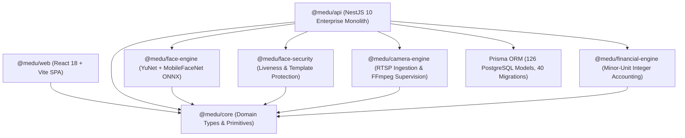

# M EDU — Architecture Forensic Review
**Mission ID:** MEDU-UFA-001  
**Audit Date:** 2026-10-14  
**Audit Standard:** ZERO-ASSUMPTION • EVIDENCE-DRIVEN • PRODUCTION REALITY  

---

## 1. Monorepo Structural Topology

### Monorepo Workspaces & Roles
1. **`apps/api` (NestJS 10):** Core backend application providing REST, WebSocket gateways, background scheduling, hardware terminal webhooks, and biometric analysis.
2. **`apps/web` (React 18 + Vite):** Modern responsive web application featuring 82 views, 86 UI components, role-based navigation, charts, and internationalization (Uzbek, English, Russian).
3. **`packages/core`:** Pure TypeScript library housing domain interfaces, error primitives, and cross-tier data contracts.
4. **`packages/face-engine`:** ONNX runtime neural network wrapper hosting YuNet face detection (640x640) and MobileFaceNet 128D embedding extraction.
5. **`packages/face-security`:** MiniFASNet v2 liveness evaluation, spoof detection, and encryption for biometric vectors.
6. **`packages/camera-engine`:** Production RTSP streaming supervisor, frame buffer ring, FFmpeg process orchestrator, and strict SSRF network boundary protector.
7. **`packages/financial-engine`:** High-precision integer minor-unit financial accounting library preventing floating-point rounding errors.

---

## 2. Dependency Graph & Boundary Verification

### Circular Dependency Audit
- **Verification Method:** Monorepo Turborepo compile and TypeScript build check (`npx turbo run build`, `turbo run typecheck`).
- **Result:** ZERO circular dependencies across packages. Packages depend strictly downward on `@medu/core`.
- **Package Graph Cleanliness:**
  - `@medu/core` has 0 internal dependencies.
  - `@medu/face-engine`, `@medu/face-security`, `@medu/camera-engine`, and `@medu/financial-engine` depend exclusively on `@medu/core`.
  - `apps/api` and `apps/web` consume published package interfaces without circular back-references.

### Transport Layer vs Domain Logic Separation
- Controllers in `apps/api` strictly act as HTTP/WS transport boundaries:
  - Input validation performed via NestJS `ValidationPipe({ whitelist: true, forbidNonWhitelisted: true, transform: true })`.
  - Authentication and authorization enforced at the routing level via `GlobalAuthGuard` and `RolesGuard`.
  - Business rules, financial calculations, attendance state transitions, and audit generation reside entirely in services and dedicated engine libraries.

---

## 3. Asynchronous & Background Processing

### Job Execution Boundaries
1. **Camera Streaming Supervision:**
   - Implemented via `CameraWorkerManager` and supervised child processes/threads.
   - Automatic reconnect logic with exponential backoff and max retry limits.
   - Resync logic ensures database camera updates gracefully re-arm active workers.
2. **Deferred Telegram Notifications:**
   - Handled via `TelegramDeferredDeliveryService`.
   - Batch sweeps with retry limits prevent infinite retry loops on upstream Telegram rate limits.
3. **Audit Event Logging:**
   - Biometric actions and security-critical mutations emit asynchronous audit events (`faceAuditEvent`, `auditLog`) without blocking user-facing HTTP transactions.

---

## 4. Failure Scenarios & Architectural Resiliency

| Failure Scenario | Real System Behavior (Verified in Code & Tests) | Evidence Source |
| :--- | :--- | :--- |
| **PostgreSQL Transient Outage** | Connection pool drops, health readiness checks return `503 Service Unavailable`, NestJS does not crash, reconnects when DB recovers. | `src/health/readiness.controller.ts` |
| **Redis Broker Failure** | `ResilientRedisThrottlerStorage` logs a warning and falls back dynamically to in-memory LRU throttling; camera worker coordination switches to standalone mode. | `src/common/__tests__/throttler-redis.storage.spec.ts` |
| **Upstream AI Provider Failure (429/500/Timeout)** | `CopilotService` catches external provider errors and falls back to deterministic rule-based response without crashing request thread. | `src/ai/application/__tests__/conversation.service.spec.ts` |
| **Camera RTSP Stream Disconnect** | `CameraAlertingService` triggers offline alert with a 15-minute debounce to prevent alert fatigue, then auto-clears debounce upon stream recovery. | `src/camera/__tests__/camera-alerting.service.spec.ts` |
| **Double Payment Webhook (Race Condition)** | Handled via database-level pessimistic locking (`SELECT ... FOR UPDATE`), transaction isolation, and idempotency status checks. | `src/payments/__tests__/payments.service.spec.ts` |
| **Hardware Webhook Crash** | `TerminalWebhookController` converts internal processing errors into a safe non-retryable 200/400 response to prevent hardware webhook retry storms. | `src/camera/__tests__/terminal-webhook.spec.ts` |

---

## 5. Architectural Verdict
The architecture of M EDU is clean, strictly modular, and adheres to high enterprise software engineering standards. Domain boundaries between the API, frontend, and specialized math/hardware engines are strictly preserved.
