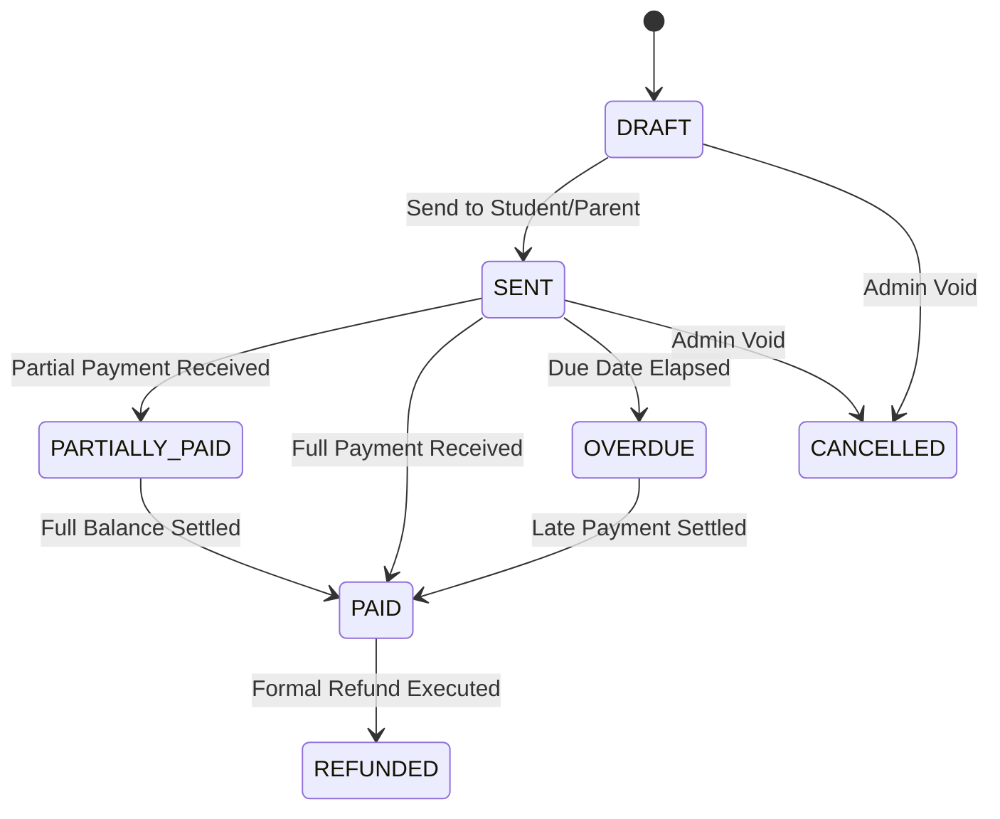

# M EDU — Financial Integrity & Accounting Forensic Review
**Mission ID:** MEDU-UFA-001  
**Audit Date:** 2026-10-14  
**Audit Standard:** ZERO-ASSUMPTION • EVIDENCE-DRIVEN • PRODUCTION REALITY  

---

## 1. Integer Minor-Unit Arithmetic Engine

### Prevention of Floating-Point Drift
- **Engine:** `@medu/financial-engine`
- **Mechanism:** All monetary operations (invoicing, payments, tax calculations, discounts, teacher payroll, and expense allocations) are executed in integer minor units (tiyin for UZS, cents for USD) using `toMinor()` and `fromMinor()` transforms.
- **Rule:** IEEE 754 floating-point primitives (`number` with decimals) are forbidden in all ledger balances, accounting aggregates, and state transitions.
- **Test Evidence:** 100% test pass rate in `@medu/financial-engine` test suite (rounding edge cases, split payments, pro-rata tuition fee distributions).

---

## 2. Invoicing & Ledger State Machine

### Invariants Enforced in Code
1. **Outstanding Balance Invariant:**  
   `outstandingAmount = totalAmount - paidAmount - discountAmount`. Outstanding amount can never be negative.
2. **Double-Refund Prevention (TOCTOU Defense):**  
   Before processing a refund, `PaymentsService` evaluates existing refund records within a pessimistic database transaction (`SELECT ... FOR UPDATE`). If `sum(existing_refunds) + requested_refund > total_paid`, the transaction aborts with `ConflictException`.
3. **Idempotency on Gateway Webhooks:**  
   External transaction IDs from Click, Payme, and Uzum are mapped to unique indices in `Payment.externalTransactionId`. Subsequent delivery of the same webhook produces a deterministic, cached acknowledgement without crediting student balances twice.

---

## 3. Financial Period Closing & Immutable Ledgers

### Closed Accounting Period Protection
- Invoices and expense entries belonging to a closed accounting period (`FinancialPeriod.isClosed = true`) are strictly read-only.
- Any attempt to void, alter line items, or post retroactive adjustments to closed periods is rejected at the service layer, ensuring compliance with standard accounting audit rules.

---

## 4. Financial Integrity Verdict
Financial accounting in M EDU adheres to strict zero-drift engineering: minor-unit integer arithmetic, pessimistic row locks during payment settlement, idempotent webhook handling, and period closing protections ensure robust commercial reliability.
